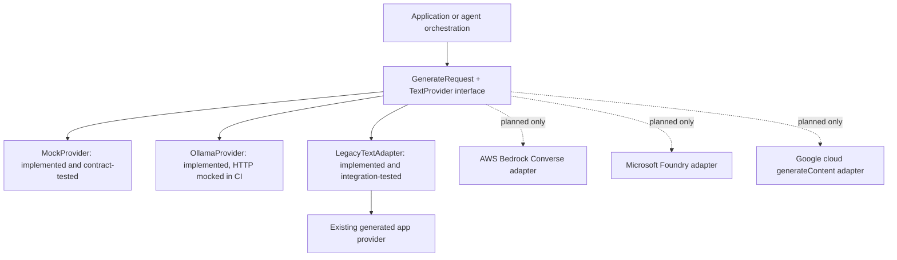

# Portable text-provider architecture reference (M6)

**Implementation status: local reference only.** This document maps a common contract to potential provider services; it does **not** claim that AWS, Azure, or Google Cloud adapters have been written, authenticated, deployed or tested.

## Architecture

The standalone package is `packages/agent-provider-contract`. It uses only the Python standard library at runtime. The request type is `GenerateRequest(prompt: str)`; the response type is `GenerateResponse(text, provider, model)`. `TextProvider.generate(request)` is a synchronous interface.

| Candidate provider | Current state | Potential API translation | Extra requirements |
|---|---|---|---|
| Deterministic mock | **Implemented and tested** | Prompt -> synthetic stable response | None |
| Local Ollama | **Implemented; fake-HTTP tested in CI** | `POST /api/generate`, nonstreaming prompt -> response text | Local Ollama install and model download for a real test |
| Existing AET generated app | **Bridged and tested** | Delegate `generate(str)->str`; wrap in typed response | Generated mock project in CI |
| AWS Bedrock | **Concept only** | Potential `Converse` request/response adapter | Model selection, IAM policy, region, SDK, budget approvals |
| Microsoft Foundry | **Concept only** | Potential deployed-model chat/Responses API adapter | Deployment, endpoint, auth/identity, rate-limit/cost reviews |
| Google cloud | **Concept only** | Potential `generateContent` adapter | Project, location, IAM, SDK/REST, budget and data-governance reviews |

**Official API references checked for this mapping (October 2026):**
- AWS Bedrock Converse: https://docs.aws.amazon.com/bedrock/latest/APIReference/API_runtime_Converse.html
- Microsoft Foundry chat completions: https://learn.microsoft.com/azure/ai-services/openai/how-to/chatgpt
- Google Cloud generateContent: https://docs.cloud.google.com/gemini-enterprise-agent-platform/reference/rest/v1/projects.locations.endpoints/generateContent

## Contract boundaries

The shared abstraction is deliberately small: one bounded UTF-8-compatible text prompt, one nonempty text result and provider/model labels. Adapters must validate input/output, surface sanitized operational failures, and never silently route a request to another provider. Model responses are not guaranteed equivalent across providers.

**Outside the M6 contract:** tool invocation, streaming, multi-turn conversation, token/accounting metadata, embeddings, multimedia, structured output, cancellation, retries, content-safety policy, audit logging, distributed tracing, throughput SLAs and authentication. Future adapters must expose or reject unsupported capabilities rather than silently pretending they work. Provider responses are untrusted text; callers must validate them and protect against instruction injection.

### Porting checklist (not yet executed for cloud)

1. Identify the chosen service, model, region, deployment and allowed data classification.
2. Implement `GenerateRequest -> provider SDK call -> GenerateResponse` under a separate optional dependency/extras group; avoid import-time cloud SDK requirements for core users.
3. Implement an injected fake transport or fake SDK client for deterministic offline contract tests.
4. Confirm authentication, redaction, egress restrictions, rate limits, costs, timeouts, cancellation and provider-specific error mapping.
5. Run consented end-to-end tests in an approved cloud environment and record results, before describing the provider as supported.
6. Document capability differences, updated service APIs, ownership and cost exposure.

## Evidence versus claims

M6 CI verifies standalone package installation, deterministic mock behavior, fake local Ollama requests and failures, and the bridge to the generated FastAPI app. **It does not execute a live local model or cloud request.** The mock adapter contract is a test of software structure, not evidence of reasoning quality or equivalent answers. No organization team adoption has yet been established.
